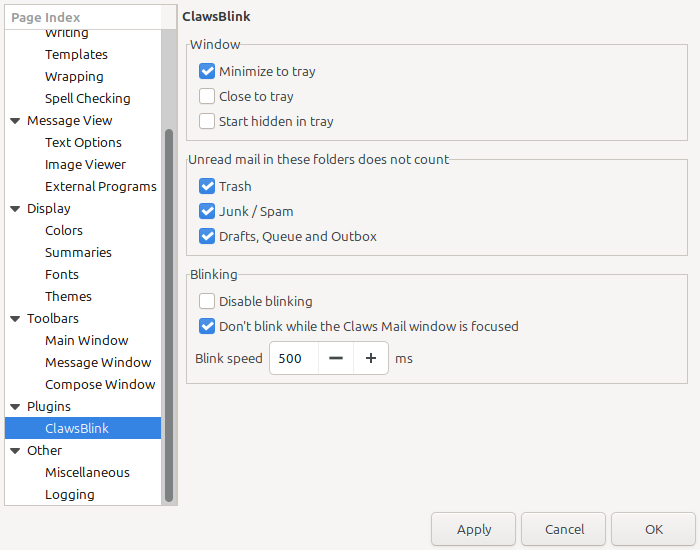

# ClawsBlink

A quiet tray icon for [Claws Mail](https://www.claws-mail.org/). The icon blinks while you have unread mail, and you can tuck Claws Mail away in the tray. It shows no popups, plays no sounds and sends no notifications.


When there's unread mail, the icon switches between coral and blue. When everything is read, it stays blue. The icon is drawn at whatever size your tray uses, so it stays sharp on any panel.

## Features

- **Blinks while you have unread mail** in any folder. Trash, Junk/Spam, Drafts, Queue and Outbox are left out by default, so they can't keep it blinking forever.
- **Stays calm while you read.** While the Claws Mail window has focus, the icon shows steady coral. It starts blinking again when you switch away.
- **Show and hide with one click.** Left-click the icon to show Claws Mail, or to hide it if it's already in front.
- **Minimize to tray, close to tray, start hidden.** Each can be turned on or off separately.
- **Tray menu.** Right-click for Get new mail, Get from all accounts, Send queued messages, Compose new message, quick toggles, Preferences and Exit.
- **Tooltip.** Hover over the icon to see new, unread and total counts (ignored folders are left out).
- **Preferences page** in Claws Mail's own Preferences window.

## Requirements

- Claws Mail 4.x built with GTK3 (the version in Debian and Ubuntu).
- A desktop with a system tray that supports XEmbed tray icons: Xfce, MATE, Cinnamon, LXQt, Budgie and others on X11.

Debian / Ubuntu:

```sh
sudo apt install build-essential pkg-config libclaws-mail-dev libgtk-3-dev
```

## Build and install

```sh
make                  # builds ./clawsblink.so
make install-user     # copies it to ~/.claws-mail/plugins/ (no sudo)
sudo make install     # or: system-wide, into Claws Mail's plugin folder
```

Then in Claws Mail open **Configuration → Plugins**, click **Load…** and choose `clawsblink.so` from where you installed it. Claws Mail loads it again on every start.

To remove it, unload it in **Configuration → Plugins**, then run `make uninstall-user` (or `sudo make uninstall`).

## Preferences

**Configuration → Preferences → Plugins → ClawsBlink**, or **Preferences…** in the tray menu.



| Option | Default | What it does |
|---|---|---|
| Minimize to tray | on | Minimizing the window hides Claws Mail in the tray. |
| Close to tray | off | The window's close button hides Claws Mail instead of quitting. Use **Exit** in the tray menu to quit. |
| Start hidden in tray | off | Claws Mail starts with only the tray icon showing. |
| Trash | on | Unread mail in Trash doesn't count. |
| Junk / Spam | on | Unread mail in folders named Junk, Spam, Junk E-mail or Bulk Mail (any capitalisation) doesn't count. |
| Drafts, Queue and Outbox | on | Unread mail in these folders doesn't count. |
| Disable blinking | off | Show a steady coral icon instead of blinking. |
| Don't blink while the Claws Mail window is focused | on | Show steady coral while you're working in Claws Mail. |
| Blink speed | 500 ms | Time between icon changes, 200–2000 ms. |

**Minimize to tray**, **Close to tray** and **Ignore Trash** are also in the tray menu. Both places stay in sync.

## Where things are stored

Settings are kept in `~/.claws-mail/clawsblinkrc`, a small plain-text file. Deleting it brings back the defaults.

## How it works

ClawsBlink is a single C file. It uses GTK3's `GtkStatusIcon` for the tray icon and listens to Claws Mail's folder update hooks. When a folder's counts change, it rescans the unread counts (changes are batched, so a big mail fetch doesn't rescan for every message). It also uses Claws Mail's hooks for minimize and close to send the window to the tray.

GTK3 no longer has built-in blinking, so ClawsBlink uses a timer to switch between its two icons. The icons are drawn with cairo at the exact size the tray asks for, and sized so the envelope always lands on whole pixels.

## Limitations

- **XEmbed trays only.** `GtkStatusIcon` uses the classic XEmbed system tray. GNOME (without an extension that adds a tray) and Wayland-only trays won't show the icon.
- **Junk/Spam is found by folder name.** A spam folder with another name isn't ignored unless you rename it.
- **One tray icon is enough.** Don't use it together with the tray icon of Claws Mail's Notification plugin, or you'll get two icons.

## License

[GPL-3.0-or-later](LICENSE) © 2026 chelovek84, the same license as Claws Mail.
